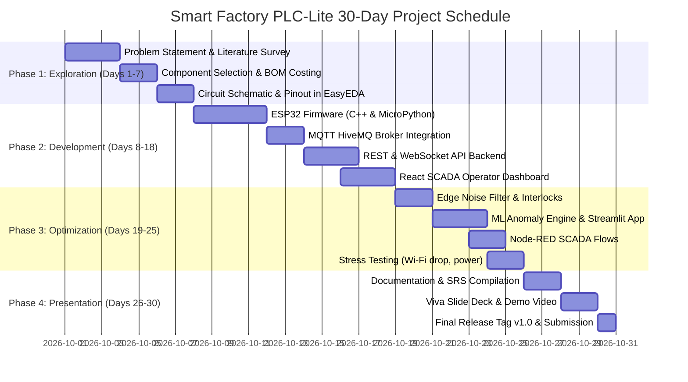

# Smart Factory PLC-Lite Automation Controller
## Step 2: Project Planning & Gantt Roadmap
**Prepared for:** HCLTech BTech Embedded Systems & IoT Curriculum  
**Duration:** 30 Days (4 Phases)  
**Version:** 1.0 | Date: November 2026  

---

### 1. Phase Breakdown & Milestones

---

### 2. Detailed Milestone Deliverables

#### Phase 1: Exploration & System Modeling (Days 1 – 7)
- **Objective:** Finalize project boundaries, bill of materials, circuit schematic, and communication architecture.
- **Key Tasks:**
  - Research industrial PLC limitations and evaluate ESP32 vs STM32 vs Raspberry Pi Pico W.
  - Complete the Bill of Materials (BOM) with commercial suppliers (Robu.in, Amazon.in).
  - Draft GPIO pin assignments in EasyEDA to prevent ADC2 Wi-Fi conflicts on the ESP32.
  - Define MQTT topic naming conventions (`factory/{service}/{deviceId}/{action}`).
- **Exit Deliverables:** Signed-off `PROBLEM_STATEMENT.md`, `BILL_OF_MATERIALS.md`, and `CIRCUIT_SCHEMATIC.md`.

#### Phase 2: Core Engineering & Development (Days 8 – 18)
- **Objective:** Build modular hardware firmware, backend APIs, and web user interfaces.
- **Key Tasks:**
  - Write ESP32 firmware in C++/PlatformIO and MicroPython with Wi-Fi auto-reconnect and PubSubClient.
  - Implement HiveMQ MQTT publish/subscribe loop with QoS 1 and retained status messages.
  - Implement Express.js backend with Mongoose schemas (Devices, Sensors, Actuators, Telemetry, Audits).
  - Develop Vite + React SCADA Operator interface featuring Dark Industrial styling.
  - Implement JWT authentication with role-based access control (Admin, Engineer, Operator, Viewer).
- **Exit Deliverables:** Working firmware, functional API endpoints, and authenticated SCADA UI.

#### Phase 3: Optimization, Intelligence & Hardening (Days 19 – 25)
- **Objective:** Add autonomous edge resilience, signal conditioning, machine learning, and stress test under realistic fault conditions.
- **Key Tasks:**
  - Embed 10-sample moving average circular buffer filter to eliminate ADC jitter on temperature, vibration, and current.
  - Implement sub-15ms edge-side autonomous interlocks: automatic fan activation at > 75°C and conveyor emergency stop at > 4.5 mm/s vibration.
  - Build Python predictive maintenance analytics with Isolation Forest anomaly detection in Streamlit.
  - Design Node-RED telemetry flows with threshold-triggered control switches.
  - Conduct realistic condition tests: Wi-Fi drop injection, power-cycle stress, and invalid MQTT packet handling.
- **Exit Deliverables:** Hardened controller code, Python analytics app, Node-RED flows, and `TEST_REPORT.md`.

#### Phase 4: Documentation, Demo & Presentation (Days 26 – 30)
- **Objective:** Prepare submission deliverables as per HCLTech BTech guidelines.
- **Key Tasks:**
  - Author complete Software Requirements Specification (`SRS.md`) and System Design (`SYSTEM_DESIGN.md`).
  - Prepare 15-slide Viva presentation deck (`PRESENTATION_DECK.md`) and recorded demo walkthrough.
  - Create comprehensive academic Project Report (`PROJECT_REPORT.md`).
  - Tag git repository with release `v1.0`.
- **Exit Deliverables:** 100% completed HCLTech Final Submission Checklist.
