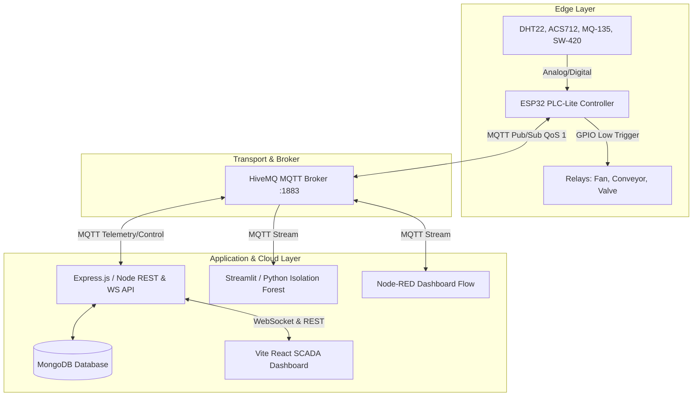

# Smart Factory PLC-Lite Automation Controller
## Step 3: Software Requirements Specification (SRS)
**Standard:** IEEE 830-1998 Compatible  
**Prepared for:** HCLTech BTech Embedded Systems & IoT Curriculum  
**Version:** 1.0 | Date: November 2026  

---

### 1. Introduction
#### 1.1 Purpose
This Software Requirements Specification (SRS) establishes the complete functional and non-functional specifications for the **Smart Factory PLC-Lite Automation Controller (Project P_180)**. It serves as the baseline contract between embedded developers, cloud engineers, plant operators, and academic evaluators.

#### 1.2 Document Conventions
- **MUST / SHALL**: Mandatory requirement for compliance.
- **SHOULD**: Highly recommended enhancement.
- **MAY**: Optional capability.

---

### 2. Overall System Description
#### 2.1 Product Perspective
The PLC-Lite system is an edge-to-cloud industrial automation ecosystem. It replaces traditional proprietary PLCs with an open ESP32 microcontroller, standard HiveMQ MQTT messaging, a cloud Node.js/Express SCADA backend, a modern Vite/React web console, and a Python Machine Learning predictive maintenance service.

#### 2.2 User Classes & Permissions
| Role | Description | Access Permissions |
|---|---|---|
| **VIEWER** | Plant Observer / Auditor | Read-only access to live telemetry, dashboards, and historical trends. |
| **OPERATOR** | Active Shopfloor Operator | Viewer rights + manual actuator override (toggle Fan, Conveyor, Valve). |
| **ENGINEER** | Controls & Automation Engineer | Operator rights + create/edit automation logic rules and cron schedules. |
| **ADMIN** | Factory System Administrator | Full system rights: User management, factory creation, audit log export. |

---

### 3. Functional Requirements (FR)

#### 3.1 Hardware Acquisition & Edge Processing
- **FR-1.1 (Multi-Sensor Acquisition):** The controller SHALL sample temperature and humidity from DHT22, vibration from SW-420/Piezo, current from ACS712, and gas level from MQ-135 every 3,000 ms.
- **FR-1.2 (ADC Channel Allocation):** All analog sensors SHALL be mapped exclusively to ADC1 pins (GPIO 32, 34, 35) to prevent hardware contention with the ESP32 Wi-Fi radio on ADC2.
- **FR-1.3 (Moving Average Signal Conditioning):** The firmware SHALL apply a 10-sample circular moving average filter to all raw analog signals to eliminate electronic high-frequency noise prior to transmission.
- **FR-1.4 (Autonomous Edge Interlocks):** 
  - If filtered temperature exceeds **75.0 °C**, the controller SHALL autonomously activate the auxiliary cooling fan relay in **< 15 ms**, sound the alarm buzzer, and publish a high-severity alert.
  - If filtered vibration exceeds **4.5 mm/s**, the controller SHALL immediately disengage the conveyor motor relay to prevent mechanical bearing seizure.
- **FR-1.5 (Watchdog Fail-Safe):** The firmware SHALL register a 15-second hardware Watchdog Timer (WDT); if the main task loop hangs, the WDT SHALL initiate a clean chip reset.

#### 3.2 Industrial Communication & Telemetry
- **FR-2.1 (MQTT Protocol Compliance):** The controller SHALL connect to HiveMQ broker (`broker.hivemq.com:1883`) using MQTT v3.1.1 with QoS 1 for reliable delivery.
- **FR-2.2 (Last Will & Testament):** The controller SHALL register an LWT message on topic `factory/status/{deviceId}` payload `{"status": "OFFLINE"}` retained by the broker upon ungraceful disconnection.
- **FR-2.3 (Standardized JSON Payload):** Telemetry packets SHALL conform to the `@smart-factory/mqtt-contracts` schema containing `deviceId`, `timestamp`, `readings`, and `actuators` sub-objects.
- **FR-2.4 (Actuator Command Subscription):** The controller SHALL subscribe to `factory/actuator/{deviceId}/control` and parse JSON commands (`TURN_ON`, `TURN_OFF`, `SET_VALUE`).

#### 3.3 Backend Cloud API & Database
- **FR-3.1 (RESTful Endpoints):** The backend SHALL expose authenticated REST endpoints for `/api/auth`, `/api/devices`, `/api/sensors`, `/api/actuators`, `/api/telemetry`, `/api/automations`, `/api/schedules`, and `/api/audit-logs`.
- **FR-3.2 (WebSocket Broadcasting):** The backend SHALL broadcast incoming telemetry, actuator state mutations, and system alerts to connected frontend clients over WebSocket (`wss://`) within **< 100 ms**.
- **FR-3.3 (Audit Logging):** Every manual or automated actuator actuation SHALL be permanently recorded in MongoDB with timestamp, executing userId/system, target device, and previous vs new state.

#### 3.4 Supervisory Control and Data Acquisition (SCADA) UI
- **FR-4.1 (Real-Time Visual Gauges):** The web console SHALL render temperature, vibration, current, and pressure gauges updated in real time without requiring browser reload.
- **FR-4.2 (Manual Control Switches):** The console SHALL provide low-latency control buttons for operators with visual confirmation of command dispatch and physical relay acknowledgment.
- **FR-4.3 (Automation Rule Builder):** Users with Engineer privileges SHALL be able to configure trigger conditions (e.g., `Sensor Temperature > 65`) and target actuator actions (`Fan = ON`).

#### 3.5 Predictive Maintenance & Machine Learning
- **FR-5.1 (Unsupervised Anomaly Detection):** The Python analytics service SHALL train an **Isolation Forest** model on baseline machine telemetry to compute real-time anomaly scores.
- **FR-5.2 (Predictive Failure Flagging):** Data points deviating significantly from the nominal vibration-current operational envelope SHALL be flagged as maintenance outliers.

---

### 4. Non-Functional Requirements (NFR)

#### 4.1 Performance Requirements
- **NFR-1.1 (Edge Response Time):** Autonomous safety shutoffs on the ESP32 must execute within **15 ms** of threshold breach.
- **NFR-1.2 (Cloud Telemetry Cadence):** Sensor data must be packaged and dispatched every 3 seconds under normal network conditions.
- **NFR-1.3 (API Response Latency):** 95% of REST API queries must respond within **< 200 ms** under a 50 concurrent user load.

#### 4.2 Reliability & Fault Tolerance
- **NFR-2.1 (Wi-Fi Self-Healing):** In the event of Wi-Fi drops, the ESP32 firmware must attempt non-blocking reconnects every 5 seconds without freezing local sensor monitoring.
- **NFR-2.2 (Database Connection Resilience):** The backend server must bind to its listening HTTP port immediately on startup and retry database connections asynchronously in a loop.

#### 4.3 Security Requirements
- **NFR-3.1 (Token Authentication):** All cloud endpoints must be secured with JSON Web Tokens (JWT) signed using HMAC-SHA256 with 15-minute access token expiry and secure refresh tokens.
- **NFR-3.2 (No Hardcoded Secrets):** Passwords, JWT secrets, database connection strings, and API keys must reside in environment variables (`.env`).
- **NFR-3.3 (Password Hashing):** All user credentials must be salted and hashed using **bcrypt** with a minimum work factor of 10.

---

### 5. Constraints & Compliance
- **CON-1:** The edge hardware is constrained to 520 KB SRAM and 4 MB Flash on the ESP32-WROOM-32.
- **CON-2:** Relay switching capacity is rated at 10A / 250V AC.
- **CON-3:** The project adheres to HCLTech Embedded Systems & IoT Training Curriculum (Version 1.0).
