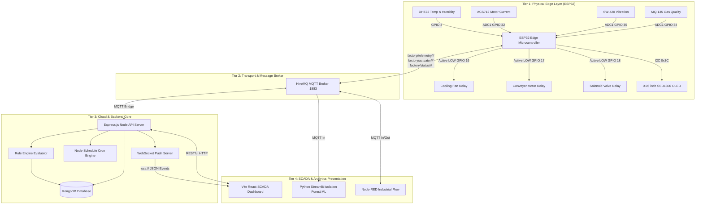
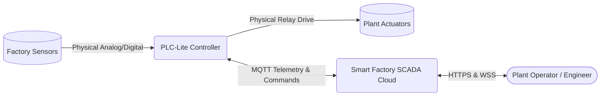
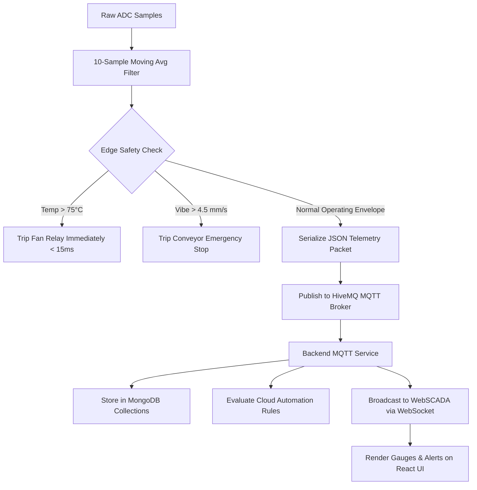
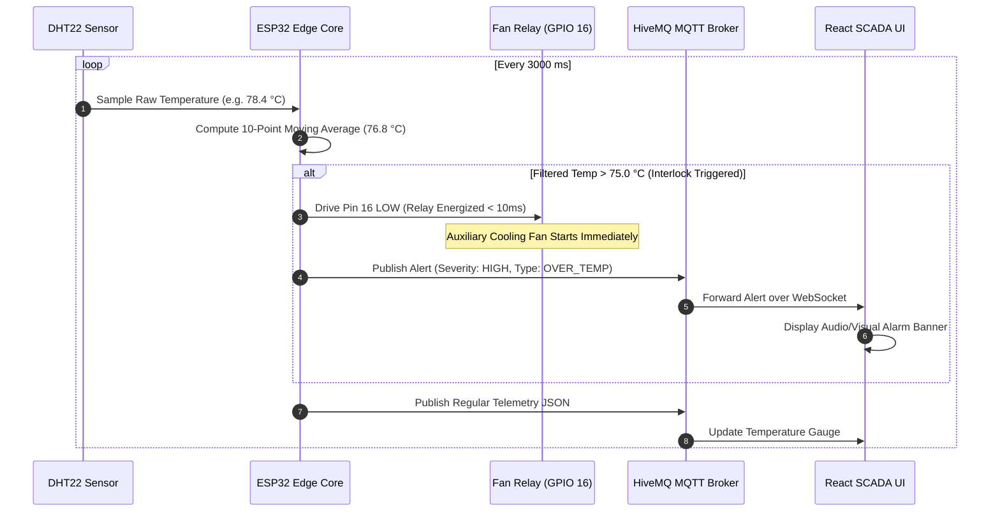
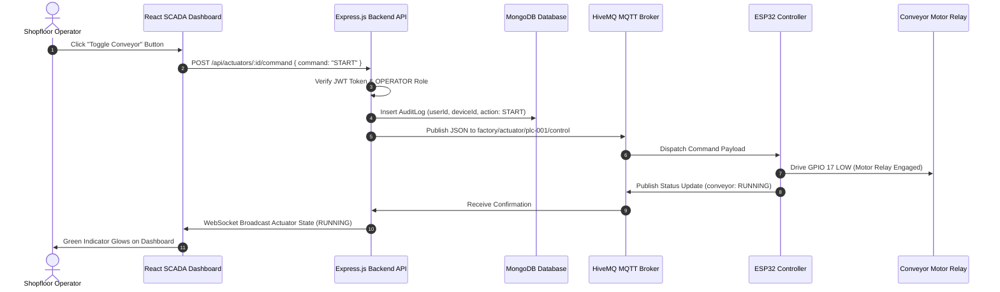
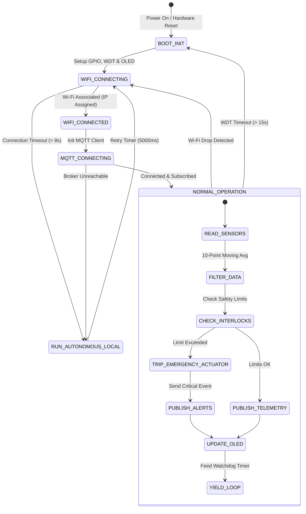
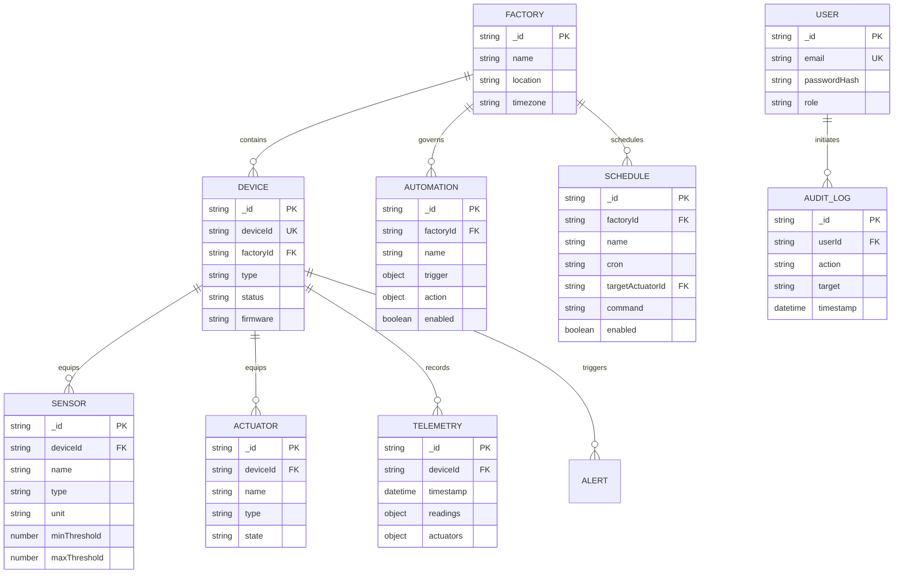

# Smart Factory PLC-Lite Automation Controller
## Step 4: System Design Document
**Prepared for:** HCLTech BTech Embedded Systems & IoT Curriculum  
**Version:** 1.0 | Date: November 2026  

---

### 1. High-Level Architecture Overview
The PLC-Lite ecosystem adopts a modern 4-tier distributed industrial architecture:
1. **Edge Physical & Controller Tier:** ESP32 hardware, industrial sensors, relay actuators, and local moving-average signal conditioning.
2. **Message Broker Transport Tier:** HiveMQ MQTT Broker providing low-overhead publish-subscribe telemetry with QoS 1 and LWT.
3. **Enterprise Backend & Automation Tier:** Node.js / Express microservice cluster with Mongoose, MongoDB Atlas persistence, and WebSocket push service.
4. **Supervisory Presentation & Intelligence Tier:** Vite React 19 Operator SCADA Console, Node-RED visual flows, and Streamlit Python ML Predictive Maintenance engine.

---

### 2. Module Boundaries & Responsibilities

| Module | Primary Technology | Core Responsibilities |
|---|---|---|
| **ESP32 Firmware** | C++ / PlatformIO & MicroPython | Hardware ADC sampling, 10-point moving average noise filtering, sub-15ms autonomous edge interlocks, HiveMQ MQTT telemetry publisher. |
| **MQTT Broker** | HiveMQ (`broker.hivemq.com:1883`) | High-throughput pub/sub routing, QoS 1 delivery, Last-Will-and-Testament (LWT) retained status broadcasting. |
| **API Gateway** | Express.js / TypeScript | RESTful CRUD APIs, JWT authentication, Mongoose ORM models, rate limiting, and audit trail persistence. |
| **Automation Engine** | Node.js / `automationService.ts` | Evaluates cloud-level if-then automation rules on incoming telemetry streams and dispatches actuator actions. |
| **Schedule Engine** | `node-schedule` / Cron | Executes time-based shift triggers (Shift Start, Shift End, Eco Night Mode) with cron syntax validation. |
| **SCADA Web App** | React 19, Vite, TailwindCSS | Industrial dark-mode workstation dashboard, animated SVG plant schematics, real-time gauges, and manual actuator overrides. |
| **ML Predictive Engine**| Python, Pandas, NumPy, Scikit-Learn | Isolation forest anomaly detection, vibration FFT analysis, power consumption calculations, and maintenance report generation. |
| **Node-RED Flows** | Node-RED Runtime | Visual drag-and-drop dashboard for rapid industrial SCADA prototyping and alert routing. |

---

### 3. Data Flow Diagrams (DFD)

#### 3.1 DFD Level 0 — Context Diagram

#### 3.2 DFD Level 1 — Detailed Data Transformation Flow

---

### 4. Sequence Diagrams

#### 4.1 Sequence: Autonomous Edge Over-Temperature Interlock

#### 4.2 Sequence: Cloud Operator Actuator Command Override

---

### 5. Controller State Machine Diagram
The ESP32 firmware operates as a deterministic, non-blocking finite state machine:

---

### 6. Database Entity-Relationship (ER) Model

